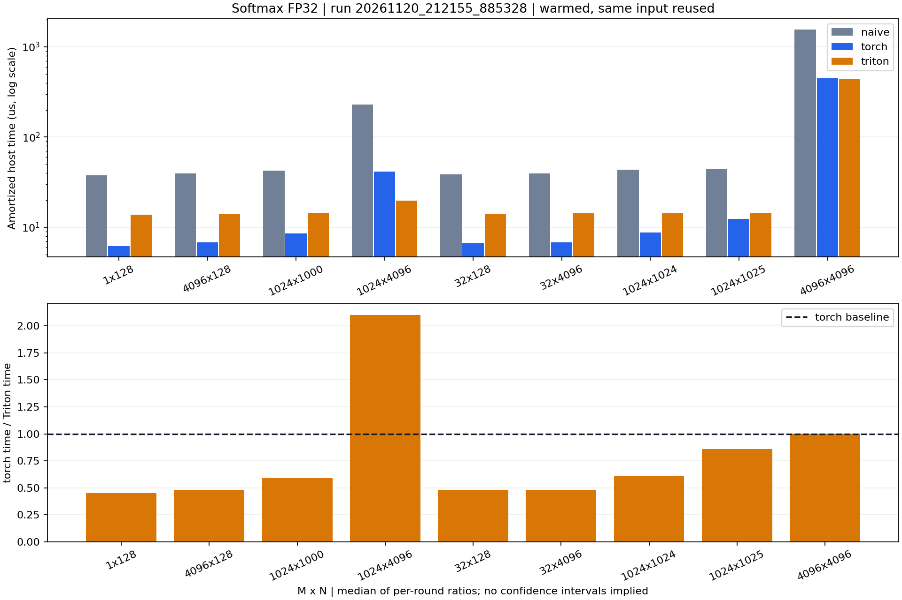

# CUDA / Triton 算子实验

用 CUDA C++、PyTorch 和 Triton 实现和验证 GPU 算子。项目从向量加法和 Attention 访存分析开始，最后通过 warp 数、缓存复用和硬件计数器对照，解释 Triton Softmax 在哪些形状上占优。

## 实验导航

| 阶段 | 做了什么 | 阅读入口 |
| --- | --- | --- |
| W9 · CUDA 和 Attention | 向量加法尾块校验、CUDA Event、原地 mask 与设备内拷贝 | [运行说明](w9/README.md) · [实验报告](w9/reports/W9_实验报告.md) |
| W10 · Triton 正确性 | 向量加法和按行 Softmax，覆盖不规则宽度、FP32/FP16、数值稳定性 | [运行说明](w10/README.md) · [实验报告](w10/reports/W10实验报告.md) |
| W11 · Softmax 性能分析 | 对照朴素 PyTorch、`torch.softmax`、Triton，分析 warp 数与 L2/DRAM 流量 | [运行说明](w11/README.md) · [实验报告](w11/reports/W11实验报告.md) |

## 代表性结果

- **W9** 在 FP32、序列长度 1024 下，原地 mask 让 Attention 前向的轮均值中位数从 **742.1 μs 降到 534.3 μs**。单独采集的时间线中少了一次约 **104 μs** 的设备内拷贝。[结果与时间线](w9/reports/W9_实验报告.md)
- **W10** 当前回归 **48/48** 通过。报告用 257 列说明尾部掩码，用 FP16 全相等输入说明输出舍入对 Softmax 行和的影响。[回归记录](w10/results/runs/20261115_225210_984586/summary.json) · [数值分析](w10/reports/W10实验报告.md)
- **W11** 在 RTX 4080 Laptop GPU 上，连续 FP32 的 1024×4096 输入对 `torch.softmax` 获得 **1.99×、1.96×、2.10×** 三次 eager 加速。设备侧诊断中，轮换八对缓冲后两者接近持平。9 个主测形状中有 7 个由 Torch 更快，收益取决于形状和缓冲区复用。[对照与归因](w11/reports/W11实验报告.md)



*图为 W11 的 11 月 20 日复跑，耗时包含 eager 调用和输出分配。硬件、计时和 Graph 诊断口径见 [W11 报告](w11/reports/W11实验报告.md)。*

## 快速开始

### 核验已有结果（CPU 即可）

需要 Python 3.12。脚本使用标准库复算原始记录、检查文档链接、运行证据完整性测试。

```bash
git clone https://github.com/hzy22543-glitch/Triton.git
cd Triton
python3 scripts/verify_project.py
```

GitHub Actions 在 Ubuntu 上运行同一套离线检查。结果日志保存在 `reports/checks/<时间>/`。

### 运行 GPU 实验

使用 Linux 或 WSL2 Ubuntu、NVIDIA GPU、支持 CUDA 的 PyTorch 环境。W9 还需要 `nvcc` 和 GNU Make，W10/W11 需要 Triton。实测环境为 **Python 3.12.3、PyTorch 2.13.0+cu132、Triton 3.7.1、CUDA Toolkit 12.8**。按机器驱动选择合适的 CUDA wheel，版本记录见 [W10](w10/requirements.txt) 和 [W11](w11/requirements.txt)。从 [PyTorch 安装页](https://pytorch.org/get-started/locally/) 选择适合当前环境的构建。

在仓库根目录激活已经配置好的 Python 环境后运行：

```bash
python -c 'import torch, triton; print(torch.cuda.is_available(), torch.__version__, triton.__version__)'
python scripts/verify_project.py --gpu

# 分别复现实验
(cd w9 && bash scripts/run_all.sh)
(cd w10 && python scripts/run_experiments.py)
(cd w11 && python scripts/benchmark_softmax.py --suite full --dtype fp32 --min-run-time 1)
```

W9 默认编译目标为 `sm_89`。其他架构可在运行前设置 `CUDA_ARCH`，取本机 compute capability 的两位数，例如 8.9 对应 89。新运行生成独立的时间戳结果目录。当前 CI 负责离线核验，GPU 实验在有 CUDA 的本机执行。

## 仓库结构

```text
w9/          CUDA、Attention、计时与 profiler
w10/         Triton 算子、正确性用例
w11/         Softmax 基准、诊断、图表和计数器
scripts/     三周统一核验入口
docs/        项目结构与检查说明
reports/     统一核验归档
.github/     离线核验工作流
```

各周的 `src/` 保存实现，`scripts/` 或 `benchmarks/` 提供入口，`reports/` 保存分析，`results/` 保留相关原始记录。历史编译产物、可执行文件及本地二进制 profiler 导出留在本机。报告引用的 CSV、JSON、图表和文本 trace 随仓库提供。更多说明见 [目录与证据索引](docs/项目整合说明.md)。

## 范围与来源

这是学习实验仓库。结果适用于各报告列出的 GPU、输入和计时条件。W9 的历史 Compute Sanitizer 受 WDDM 调试接口限制，状态为未验证。W11 的 Softmax 结果来自算子基准，模型服务集成尚未测试。各周报告保留教程来源、作者实践与 AI 辅助说明。
