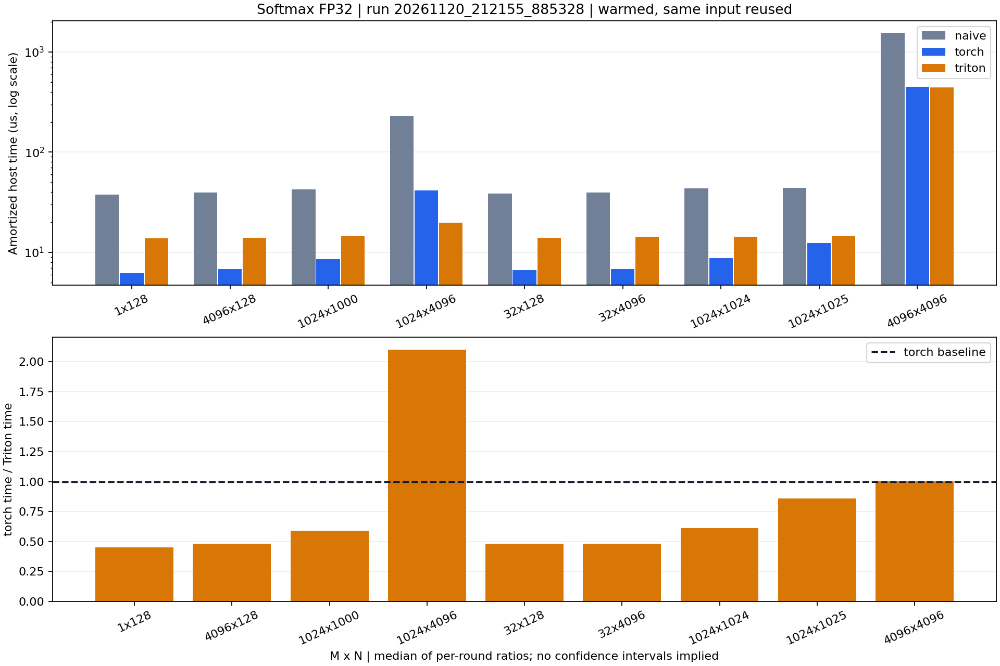
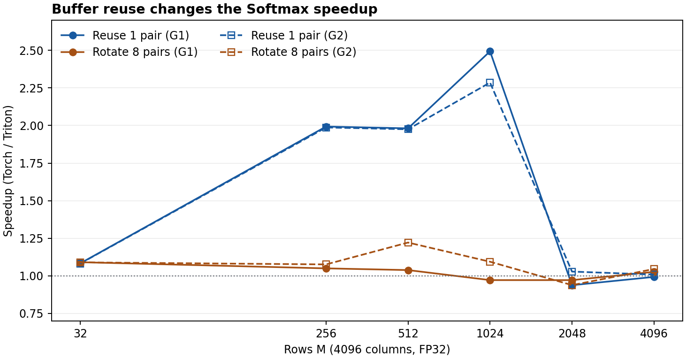

# W11 实验报告：Softmax 性能对比与收益边界

补测日期为 2026-11-20（Asia/Shanghai），结果分析于 2026-11-21 补充。实验设备为 RTX 4080 Laptop GPU。本报告对比朴素 PyTorch 表达式、`torch.softmax` 和源自 W10 的 Triton 按行 Softmax。

## 1. 结论

**在原实验的 9 个连续 FP32 形状里，Triton 对 Torch 有可重复明显优势的是 1024×4096。** 11 月 20 日复跑得出 **41.360 → 19.740 μs，2.10×，耗时下降约 52%**。此前两次完整运行是 **1.991×、1.962×**，三次运行方向一致。

- **为什么两边都复用 L2，Triton 仍能快约 2 倍。** 固定复用时，两边的 L2 扇区命中率都约 98%，DRAM 流量都很低。此时最直接的解释是每行的线程组织不同。PyTorch 使用 32 个 warp，Triton 使用 4 个 warp，让每个线程处理更多元素，并允许同一 SM 并行推进更多行。只把同一个 Triton kernel 的配置改成 32 个 warp，设备侧耗时就从约 **15 μs 升到 33 μs**，接近 PyTorch 的 **34～37 μs**。
- **什么时候优势消失。** 同样是 1024×4096，预分配并复用一对输入输出缓冲时，CUDA Graph 口径下为 **2.29～2.49×**。轮换八对缓冲后变为 **0.97～1.09×**，两种实现的 L2 扇区命中率均由约 **98%** 降到约 **50%**。固定缓冲复用有利于显露 kernel 的执行效率差异。
- **哪些形状选 Torch。** 本实验的 eager 计时中，1×128、32×128、32×4096、4096×128，以及 1024×1000/1024/1025，均是 Torch 更快。4096×4096 基本持平。设备侧额外扫描的收益只适用于相应的 Graph 和缓冲复用条件，见第 5 节。
- **相对 naive。** 新一轮的 9 个形状上 Triton 全部更快。naive 是用来展示融合的教学基线，选型用已融合的 `torch.softmax` 作对照。

## 2. 环境、口径与证据

| 项目 | 配置 |
|---|---|
| 硬件 | RTX 4080 Laptop GPU，58 个 SM，CUDA 驱动接口报告 L2 为 48 MiB，约 12 GiB 显存，compute capability 8.9 |
| 软件 | WSL2 Ubuntu，驱动 596.36，Python 3.12.3，PyTorch 2.13.0+cu132，Triton 3.7.1 |
| 输入 | 连续二维 CUDA FP32，按行归一化，随机种子 42。同一形状的实现使用相同输入 |
| eager 主基准 | `torch.utils.benchmark.Timer.blocked_autorange`，25 次预热，9 个形状，三实现轮换测量顺序，3 轮，每实现每轮目标预算 1 秒 |
| 设备侧诊断 | Torch `out=` 与原 Triton kernel 写入预分配输出，CUDA Event 测一张含 64 次调用的 CUDA Graph，再除以 64。每组 15 个样本，分组顺序随机交错，两个独立进程 |
| 诊断变量 | 固定复用 1 对缓冲，或在同一 replay 内轮换 8 对。两种模式都提前预热，算子、形状、dtype 和图节点数一致 |
| 硬件计数器 | Nsight Compute 对整张 64 节点 Graph 采样，分别测 DRAM 读写、L2 扇区命中率、活跃 warp 比例。每实现每条件取 3 次 replay 的中位数 |

eager 时间包含 Python 调用、输出分配与同步摊销，输入生成、正确性、首次 JIT 和预热在计时外。每个样本是块时间除以块内调用数，主表耗时为各轮中位数的中位数。eager 倍率由同轮 Torch / Triton 耗时比再取中位数。Graph 倍率取两边的设备侧样本中位数之比，包含图内 kernel 间隔。两个计时口径分别解读，不直接相减估算 Python 开销。

补测时显示处于活动状态，电源策略和后台 GPU 负载未全程控制。保留各轮、各样本及 GPU 前后快照。波动较大的条件结合独立复测解读。

| 证据 | 用途 |
|---|---|
| [A](../results/runs/20261114_235759_401784/summary.md) / [B](../results/runs/20261115_000009_663517/summary.md) | 历史完整 eager FP32 复核 |
| [R](../results/runs/20261120_212155_885328/summary.md) | 11 月 20 日完整 eager FP32 复跑，27 项输出检查、81 个计时组 |
| [U1](../results/runs/20261114_235210_573287/summary.md) / [U2](../results/runs/20261114_235338_715797/summary.md) | 用户较早的两次 minimum 运行，1024×4096 分别 2.048× / 1.934× |
| [G1](../results/diagnostics/20261120_212402_284769/graph_timings.json) / [G2](../results/diagnostics/20261120_212658_740981/graph_timings.json) | 两次设备侧诊断，每次 14 个形状、59 个计时组，每组 15 个样本 |
| [启动配置](../results/diagnostics/20261120_212402_284769/launches.json) | G1 的 19 组短 trace，每组 3 次调用，采样用于确认 kernel、grid 和 block |
| [硬件计数器](../results/diagnostics/20261120_212402_284769/graph-counters) | 3 种形状/缓冲条件的整图计数器原始记录 |
| [正确性](../results/correctness/20261114_235749_487696/summary.json) / [原始数据核验](数据核验与对照.md) | 独立 34 项正确性、eager 的全量复算及历史异常，另有 [机器可读对照](comparisons.json) |

正确性 34/34 覆盖 FP32/FP16 的数值样例、空输入及非法输入。FP32/FP16 最大绝对误差分别为 5.96e-8、7.63e-6，最大行和误差为 2.38e-7、2.44e-4。R 的 27 项计时前比较包含 9 项 Torch 自对照。设备侧诊断逐组检查形状、dtype、有限值、误差和行和，覆盖参与计时的缓冲及 warp 配置。

## 3. 哪些形状在 eager 更快

三列时间来自 R，单位 μs。倍率统一为 Torch 耗时 / Triton 耗时。

| M×N | naive R | Torch R | Triton R | 倍率 A / B / R | 三次完整运行的判断 |
|---|---:|---:|---:|---:|---|
| 1×128 | 37.889 | 6.226 | 13.819 | 0.485 / 0.538 / 0.450 | Torch 明显更快 |
| 32×128 | 38.489 | 6.634 | 14.016 | 0.507 / 0.511 / 0.479 | Torch 明显更快 |
| 32×4096 | 39.635 | 6.838 | 14.221 | 0.450 / 0.471 / 0.482 | Torch 明显更快 |
| 4096×128 | 39.653 | 6.778 | 13.972 | 0.476 / 0.486 / 0.482 | Torch 明显更快 |
| 1024×1000 | 42.464 | 8.589 | 14.509 | 0.498 / 0.682 / 0.591 | Torch 更快 |
| 1024×1024 | 43.497 | 8.709 | 14.286 | 0.585 / 0.501 / 0.609 | Torch 更快 |
| 1024×1025 | 43.910 | 12.369 | 14.421 | 0.726 / 0.906 / 0.860 | Torch 更快，幅度有波动 |
| **1024×4096** | 230.364 | **41.360** | **19.740** | **1.991 / 1.962 / 2.100** | **Triton 明显更快** |
| 4096×4096 | 1556.099 | 446.964 | 445.999 | 1.039 / 1.015 / 1.002 | 基本持平 |



图展示 R 的中位数，图表记录见 [source.json](figures/source.json)。R 中 1024×4096 三轮同轮倍率为 2.094、2.100、2.102，Torch 各轮中位数为 41.318～41.449 μs，Triton 为 19.661～19.748 μs。相较历史 B 轮，两边绝对耗时都有上升，单次运行的绝对值受环境影响。历史 1024×1000 的 Triton 一度出现约 84 μs 的异常轮，保留在全量对照中。

### 小矩阵、窄行和中间宽度为何表现不同

- **行少时，设备侧节省不足以抵消 eager 调用成本。** 1×128、32×128 和 32×4096 固定复用缓冲的 Graph 计时都在约 1～3 μs。两者通常只相差零点几微秒，而 eager 里的 Triton 在这些条件约 14 μs，Torch 约 6～7 μs。32×4096 虽然行宽与收益组相同，整个 grid 只有 32 个 CTA，少于设备的 58 个 SM。它也说明宽行本身不足以推出 eager 提速。
- **4096×128 是窄行调度的反例。** Trace 显示 Torch 用 warp 路径，每个 CTA 处理约 8 行，grid 512。Triton 一行一个 CTA，grid 4096，每行仍用 128 线程。复用缓冲时 Graph 约 **3.25 vs 7.82 μs**，轮换后仍约 3.18 vs 7.84 μs。Torch 的窄行组织在设备侧已占优。
- **1024×1000、1024×1024 和 1024×1025 的设备差距较小。** G1 固定复用时分别为 **5.85 vs 4.54**、**5.67 vs 4.39**、**8.37 vs 5.42 μs**（Torch vs Triton），这三组在 eager 里均由 Torch 获胜。N 从 1024 到 1025 时 Triton 核内块宽从 1024 补到 2048，Graph 中位数增长约 23%，eager 只从 14.286 μs 变到 14.421 μs。块宽变化会改变布局和规约，但不能直接换算为耗时翻倍。

### 对 naive 快很多，为何对 Torch 的收益小得多

在 1×128 上，naive、Torch、Triton 分别用 37.889、6.226、13.819 μs。把基线换成 naive 会得到约 **2.74×**，而实际替换 Torch 会让耗时变成约 **2.22 倍**。短 trace 中更大的两个观测形状也显示 naive 每次跑 5 个 kernel，两种融合实现各跑 1 个。对短小输入，多次调用和中间结果的成本可能已经超过了实际计算本身，因此融合相对 naive 的收益很大。

对 1024×4096，naive 需要约 230.4 μs，Triton 约 19.7 μs，看上去接近 12 倍。真正和同为单 kernel 的 Torch 比较时只有 2.10 倍。这部分差异需要结合下文的每行线程数和缓冲复用来解释。两组对照分别反映融合的价值，以及换掉现有融合实现还能省多少时间。[eager 复跑](../results/runs/20261120_212155_885328/summary.md) · [短 trace](../results/profiles/20261115_000301_004813/summary.json)

## 4. 1024×4096 的约 2 倍从哪里来

### 4.1 两边都复用 L2 时，为什么 Triton 仍然更快

历史 [短 trace](../results/profiles/20261115_000301_004813/summary.json) 在 32×128、1024×4096 上均显示每次调用 naive/Torch/Triton 启动 **5 / 1 / 1** 个 kernel。朴素实现拆成最大值、减法、指数、求和、除法，并有中间张量。相对 naive 的融合收益不能直接用于解释 Triton 对 Torch 的差距。

G1/G2 中，Torch 与默认 4-warp Triton 都有 1024 个 CTA，均一行一个 CTA。Torch 使用 `cunn_SoftMaxForwardReg`，Triton 在同一个 program 内执行 load、max、exp、sum、归一化和 store。N=4096 恰好是二次幂，每行没有补齐造成的无效列。区别在于每行用了多少线程、每线程持有多少数据，以及跨 warp 归约的布局。按每行均摊，1024 线程每线程处理 4 个元素，128 线程每线程处理 32 个元素。

| 1024×4096 实现 | warp/CTA | 线程/CTA | 寄存器/线程 | 静态上限 CTA/SM | G1 / G2 固定复用 μs |
|---|---:|---:|---:|---:|---:|
| Torch | 32 | 1024 | 30 | 1 | 37.434 / 34.263 |
| Triton 默认 | 4 | 128 | 54 | 9 | 15.012 / 14.988 |
| Triton 8 warps | 8 | 256 | 34 | 6 | 14.233 / 14.220 |
| Triton 16 warps | 16 | 512 | 25 | 3 | 14.171 / 14.176 |
| Triton 32 warps | 32 | 1024 | 22 | 1 | 32.889 / 33.330 |

这组线程组织改变了两件事。

1. **一行内如何归约。** Softmax 每行要归约两次，先求最大值，再求指数和。4-warp 版本让每个线程处理更多元素，可先在自己负责的元素中做局部归约，再合并 4 个 warp 的部分结果。PyTorch 这条 32-warp 路径需要合并更多 warp 的部分结果。两种布局的线程内工作和跨 warp 协作比例不同。
2. **一个 SM 能同时推进多少行。** Ada 的每 SM 上限为 48 个活跃 warp，32-warp CTA 一次最多驻留一个。按 trace 的资源估算，默认 Triton 最多可同时驻留 9 个较小的 CTA，给 SM 更多独立行任务可调度。表中的 1 和 9 都是静态上限。两边整个 grid 都是 1024 个 CTA，实验没有测量单个 CTA 调度或退出的开销。[NVIDIA Ada 调优指南](https://docs.nvidia.com/cuda/ada-tuning-guide/index.html#occupancy)

**最直接的证据是 Triton 自身的 warp 数对照。** 保持算法、输入输出、缓冲复用方式和 CTA 数相同，只把 `num_warps` 从 4 改到 32，两次测量都由约 **15 μs 增至 33 μs**，接近 PyTorch 的 **34～37 μs**。这组对照重现了大部分设备侧差距，支持线程配置及其带来的代码生成变化是关键因素。归约布局、指令和资源占用也随之变化，各项贡献没有单独测量。固定缓冲时，整图实测的活跃 warp 比例为 PyTorch 约 65%、默认 Triton 约 62%，因此更多可驻留的 CTA 只说明调度余量。8/16 warp 也约为 14 μs，进一步说明 4 warp 只是该形状下表现较好的一种配置。

### 4.2 缓存复用是优势的条件

一对连续 FP32 输入输出的逻辑工作集是 `2 × M × N × 4` 字节。1024×4096 为 **32 MiB**，小于本机 **48 MiB L2**，八对轮换是 **256 MiB**。4096×4096 即使只用一对也有 **128 MiB**。工作集与 L2 的比较给出预期，整图硬件计数器提供了实测证据。

| 形状、模式 | L2 扇区命中率 Torch / Triton | Torch DRAM 读 / 写 MiB 每调用 | Triton DRAM 读 / 写 MiB 每调用 | G1 / G2 倍率 |
|---|---:|---:|---:|---:|
| 1024×4096，复用 1 对 | 97.65% / 98.44% | 0.77 / 0.17 | 0.50 / 0.20 | 2.49 / 2.29 |
| 1024×4096，轮换 8 对 | 50.24% / 49.46% | 17.62 / 16.44 | 17.40 / 16.25 | 0.97 / 1.09 |
| 4096×4096，复用 1 对 | 49.61% / 50.40% | 70.37 / 65.36 | 71.47 / 67.03 | 0.99 / 1.01 |

计数器以三次整图采样的中位数汇总，DRAM 字节数除以 64 次调用再转为 MiB。L2 命中率是工具的扇区指标，约 50% 不等于“输入有一半来自缓存”。采样未固定 GPU 频率，保留本机运行环境，计数器用于解释方向。另做的 [单 kernel 采样](../results/diagnostics/20261120_212402_284769/counters) 对采样边界较敏感，复用时单次之间波动较大，因此以整图计数作为复用证据。

固定复用时，两边 DRAM 流量都很低，Triton 仍然快很多，说明差距不是因为 Torch 每次多读一整遍显存。换成轮换后，两边单次 DRAM 读写都增加到约 34 MiB，Graph 时间从 **37.43 / 15.01 μs** 变为 **103.64 / 106.65 μs**（G1，Torch / Triton）。结合 G2，两边近似持平。4096×4096 在同一行宽和线程配置下也增加到相近的大量 DRAM 流量，收益接近消失。结果支持：访存压力上升后，两边的共同成本占比提高，固定复用时的线程组织优势被大幅压缩。

## 5. 额外扫描：收益区间有多宽

表中是 Graph 口径，固定输出分配，倍率取两边中位数之比。表里“输入输出”包含一对 FP32 张量，轮换时乘八。设备侧获益形状的 eager 结果取决于封装成本，新增形状只完成下列诊断。

| 形状 | 一对输入输出 | G1 复用 Torch / Triton μs | 复用倍率 G1 / G2 | 轮换倍率 G1 / G2 |
|---|---:|---:|---:|---:|
| 32×4096 | 1 MiB | 2.512 / 2.320 | 1.08 / 1.08 | 1.09 / 1.09 |
| 256×4096 | 8 MiB | 10.248 / 5.141 | 1.99 / 1.99 | 1.05 / 1.08 |
| 512×4096 | 16 MiB | 17.827 / 8.997 | 1.98 / 1.98 | 1.04 / 1.22 |
| 1024×4096 | 32 MiB | 37.434 / 15.012 | 2.49 / 2.29 | 0.97 / 1.09 |
| 2048×4096 | 64 MiB | 206.978 / 220.688 | 0.94 / 1.03 | 0.97 / 0.94 |
| 4096×4096 | 128 MiB | 528.449 / 532.119 | 0.99 / 1.01 | 1.03 / 1.05 |
| 1024×2048 | 16 MiB | 11.377 / 8.186 | 1.39 / 1.39 | 0.99 / 0.99 |
| 1024×3072 | 24 MiB | 33.106 / 11.418 | 2.90 / 2.60 | 0.71 / 0.87 |



图中每个点来自表内 G1 或 G2 的同形状中位数之比，横轴为对数刻度。水平线是两种实现持平的位置。

固定 N=4096 时，**256～1024 行**是测到的设备侧收益区间。32 行降到约 1.08 倍，2048～4096 行也接近持平。固定 M=1024 时，N=3072 复用得益明显，轮换时却两次都落后。行数、列数、实际 kernel 路径、缓冲重用和调用口径缺一项都可能改变选型。

在 1024×3072 这组，固定复用时 Triton 两次都约 **11.4 μs**，Torch 约 **29.7～33.1 μs**。改成轮换后，Torch 约 **78.5～78.7 μs**，Triton 增到 **90.3～110.2 μs**，两次都更慢。一对输入输出是 24 MiB，八对轮换则约 192 MiB。Triton 的数据块宽从 3072 补到 4096，每行有四分之一位置被屏蔽。工作集变大后，两版访问路径之间的差异可能更容易显现，布局或归约中的额外工作也可能占更大的比例。填充在复用和轮换时都存在，要解释这次反转，可以优先对 3072 同时测两种模式的 L2/DRAM 计数和实际 kernel 配置，再与 4096 的记录比较。[G1 样本](../results/diagnostics/20261120_212402_284769/graph_timings.json) · [G2 样本](../results/diagnostics/20261120_212658_740981/graph_timings.json)

## 6. 复现、验证与适用范围

从 WSL Bash 运行：

```bash
cd w11  # from the repository root
python scripts/check_correctness.py
python scripts/benchmark_softmax.py --suite full --dtype fp32 --rounds 3 --min-run-time 1 --note '记录实际电源模式和后台 GPU 负载'
python scripts/diagnose_softmax.py
python scripts/analyze_results.py --plots --plot-run 20261120_212155_885328
python -m unittest discover -s tests -v
```

基准与诊断各自以时间戳留档。整图 Nsight Compute 采样可运行 [采样脚本](../results/diagnostics/20261120_212402_284769/run_ncu_probe.sh)，参数传入一个新建的输出路径名，例如 `bash results/diagnostics/20261120_212402_284769/run_ncu_probe.sh /tmp/w11-ncu-nov20`，要求本地 Nsight Compute 和 GPU 计数器可用。原始 trace、原始计时、输出校验、环境和源码快照可随对应运行核对。离线核验通过 **8 次 eager 运行、52 个形状/dtype 条件、468 个计时组**，数据完整性测试 7 项通过。两次 Graph 的样本中位数、组数及源码快照哈希另行核对。

这些性能数字适用于本机环境的连续 FP32 前向。FP16 目前有正确性和四形状冒烟记录，形状结论以 FP32 为限。复用与轮换是实验访问模式，线上工作负载的缓存和调用开销需另测。算子层收益尚未验证到 Attention、vLLM 或模型服务。

核心算子源自 W10，SHA256 为 `871386043345a45f973638ef2c234ce92097139e3457ce4f03165ace3ccc2d06`。补测、证据核验与文档编写使用了 AI 辅助。方法参考官方教程。[PyTorch Benchmark](https://docs.pytorch.org/tutorials/recipes/recipes/benchmark.html) · [Triton Fused Softmax](https://triton-lang.org/main/getting-started/tutorials/02-fused-softmax.html)

