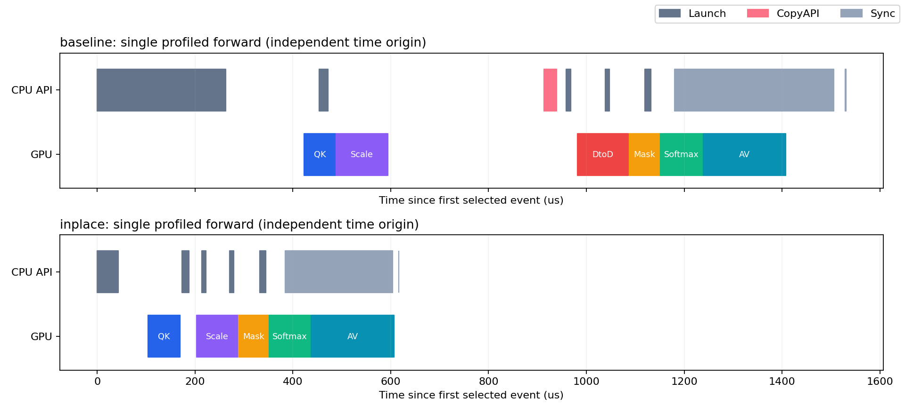
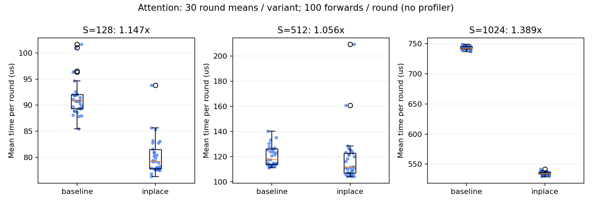

# W9 巩固学习：核心代码、参数与性能分析

更新：2026-11-05。对应本项目整理后的源码和 2026-11-04 实验结果。

本文不重讲 C++/Python 基础语法、环境安装和普通矩阵乘法。重点是：**能独立写出关键代码，知道参数控制什么，知道测试与测量分别能证明什么。**

已有文件分工：

- [README](../README.md)：如何运行项目。
- [原学习指南](W9_学习与实验指南.md)：任务步骤与练习安排。
- [实验报告](../reports/W9_实验报告.md)：实际测到了什么。
- 本文：这些实现为什么这样写、哪些结论容易理解错。

## 0. 阅读路线与使用方法

不用一次通读。建议分三次，每次读完一部分就关闭文档重写小段代码。

| 轮次 | 重点 | 需要能独立写出的内容 |
|---|---|---|
| 第一轮 | 第 1～3 节：CUDA 与计时 | kernel 启动、错误检查、Event 计时 |
| 第二轮 | 第 4～6 节：Attention、测试、参数 | 因果 mask、前缀参考、基准循环 |
| 第三轮 | 第 7～10 节：解释结果与练习 | trace 分析、CSV 汇总、结论与限制 |

每段代码都标明“项目代码摘录”“补充示例”或“待实现练习”。摘录不一定包含全部 import 和资源释放；完整可运行版本以链接的源文件为准。除明确说明外，命令在 WSL Bash 中执行。

本文中新练习的结果都留空。742.087 μs 等数字来自已有报告，不能冒充你之后复测的新数据。

## 1. 先区分三种问题：正确、快、为什么快

假设你把普通 mask 改成原地 mask，需要回答三个不同问题：

| 问题 | 需要什么证据 | 本项目的做法 |
|---|---|---|
| 结果对不对？ | 与预期输出比较，覆盖边界 | vector add 全量比较；Attention 等价、参考、因果性测试 |
| 本次是否更快？ | 统一条件、关闭 profiler 的重复测量 | Event、相同输入、ABBA、多轮 CSV |
| 为什么可能更快？ | 观察实现路径变化，排除替代解释 | trace 中 clone/copy、DtoD 消失，结合规模变化 |

第一项通过不意味着第二项成立。第三项找到一次拷贝，也不意味着可以把全部性能差额都归因于这次拷贝。

本项目的一条完整论证是：

> 两版通过输出检查；原地版本的 trace 少了一次设备内拷贝；同输入、无 profiler 的前向对照在 S=1024 下耗时下降。因此，这种原地修改在本次条件下有收益，减少复制是有证据的原因之一。

不能把最后一句改成“vLLM 服务快了 28%”：这里没有运行请求排队、网络传输、采样、KV Cache 或完整模型服务。

## 2. CUDA 代码：从线程编号到可靠的主机程序

对应文件：[整数边界测试](../src/vector_add.cu)、[浮点基准](../src/vector_bench.cu)。整数版本负责边界练习；浮点版本同时包含校验和性能测量。

### 2.1 `<<<blocks, threads>>>` 究竟传了什么

项目代码摘录：

```cpp
__global__ void vectorAdd(const float* a, const float* b, float* c, int n) {
    int i = blockIdx.x * blockDim.x + threadIdx.x;
    if (i < n) c[i] = a[i] + b[i];
}

const int threads = 256;
const int blocks = (n + threads - 1) / threads;
vectorAdd<<<blocks, threads>>>(da, db, dc, n);
```

要区分两组参数：

| 位置 | 含义 | 不是哪种意思 |
|---|---|---|
| `<<<blocks, threads>>>` | 本次启动的 grid 大小和每个 block 的线程数 | 不传给 kernel 形参 n |
| `(da, db, dc, n)` | kernel 接收的设备地址和有效元素数 | 不是分配内存的请求 |
| `__global__` | 定义一个可启动的 CUDA kernel | 不表示函数中每条语句都同时完成 |
| `const float* a` | 通过此指针不修改 a 指向的元素 | 不表示指针地址在所有线程中不同 |

更完整的启动形式是 `<<<grid, block, shared_memory_bytes, stream>>>`。本项目省略后两项：未请求动态共享内存，使用默认流。现在先掌握这两项的用途，不需要为了凑参数增加共享内存或多流。

`blocks` 是总共安排多少个 block，**不等于 GPU 的 SM 数量，也不表示这些 block 必须同时驻留**。运行时可以分批调度。

N=1000、threads=256 时，blocks=4。第 4 个 block 的线程编号为 0～255，对应全局 i=768～1023，其中 i=1000～1023 不写输出。`if(i<n)` 解决的是尾部越界；向上取整解决的是尾部元素没有线程覆盖，两者缺一不可。

补充概念：warp 是 NVIDIA GPU 上由 32 个线程组成的执行分组；block 可以包含多个 warp。256 线程意味着每个 block 有 8 个 warp，不意味着每个 warp 处理 256 个元素。block 也不是“256 个固定物理核心”的别名。

CUDA 启动与线程层级可核对 [CUDA 12.8 编程指南](https://docs.nvidia.com/cuda/archive/12.8.0/cuda-c-programming-guide/index.html#thread-hierarchy)。这里的 N=1000 等计算是对本项目的推导。

### 2.2 为什么用 256，能否换成 128 或 512

256 是当前实现的一个合理起点，不是正确答案或性能最优证明。改变 threads 会同时改变：

- block 数量；同一个 N 的工作如何分组。
- 每个 block 的 warp 数，以及资源占用方式。
- 最后一个 block 的空闲线程数。

还可能影响可驻留 block/warp 数，但需要结合寄存器、共享内存及硬件限制；不能只看 threads 数字判断速度。

只有在“输入、编译条件、测量口径均固定”后，比较不同 threads 才有意义。先确认 128/256/512 都输出正确，再测它们。不要将“更大的 block”直接解释成“更多并行”。

**为什么当前 kernel 不需要 `__syncthreads()`？** 每个线程只读 a[i]、b[i]，只写自己的 c[i]，没有线程间数据依赖。增加 block 内屏障没有解决实际问题。若将来写 shared-memory reduction，才需要在读写依赖处考虑同步；屏障不能随意放进只有部分线程执行的条件分支。

### 2.3 设备指针、字节数与复制方向

项目代码摘录：

```cpp
const std::size_t bytes = static_cast<std::size_t>(n) * sizeof(float);
std::vector<float> a(n), b(n), c(n);  // 主机端存储
float *da, *db, *dc;                 // 保存设备地址的主机变量

CUDA_CHECK(cudaMalloc(&da, bytes));
CUDA_CHECK(cudaMalloc(&db, bytes));
CUDA_CHECK(cudaMalloc(&dc, bytes));
CUDA_CHECK(cudaMemcpy(da, a.data(), bytes, cudaMemcpyHostToDevice));
CUDA_CHECK(cudaMemcpy(db, b.data(), bytes, cudaMemcpyHostToDevice));
```

| 参数/表达式 | 必须理解的含义 |
|---|---|
| `bytes` | API 要字节数，不是元素数；float 在本项目里为 4 字节 |
| 先转 `size_t` 再乘 | 让乘法在足够宽的无符号类型里进行；更大的数组时避免先用 int 乘法溢出 |
| `&da` | 分配函数要把返回的设备地址写进 da，因此传 da 变量的地址 |
| `a.data()` | 主机 vector 的连续元素地址 |
| `cudaMemcpy(dst, src, bytes, kind)` | 顺序是目标在前、源在后，不是“源、目标” |
| `cudaMemcpyHostToDevice` | 从主机内存复制到设备内存 |

主机代码不能把 `da[i]` 当成普通主机数组去解引用。da 是保存在主机变量里的设备地址，实际访问应由 kernel 或相应 CUDA API 完成。

为什么不把 c 先复制到 dc？因为 kernel 对每个有效 i 都会覆盖 dc[i]，不会读它的旧值。给输出复制初始值只增加工作。反过来，如果 kernel 计算的是 `c[i] += ...`，就必须先建立 c 的初始值；要看算法是否读取旧输出。

复制结果回主机时是：

```cpp
CUDA_CHECK(cudaMemcpy(c.data(), dc, bytes, cudaMemcpyDeviceToHost));
```

本项目先显式同步来定位错误，再用同步复制读回。不要据此推出“所有 cudaMemcpy 都有完全相同的主机阻塞行为”；复制方式、方向、内存类型与 Async 接口会影响具体行为。

### 2.4 为什么要分开检查启动错误与执行错误

项目代码摘录：

```cpp
vectorAdd<<<blocks, threads>>>(da, db, dc, n);
CUDA_CHECK(cudaGetLastError());
CUDA_CHECK(cudaDeviceSynchronize());
```

kernel 启动表达式不直接给你一个普通 `cudaError_t` 返回值。`cudaGetLastError()` 用来取得并清除当前线程记录的 CUDA 错误状态，在这里用于检查启动是否出错；它不等待 kernel 完成，不能独自证明执行没有越界。

执行阶段的问题可能直到同步或后续 API 才报告。因此，在正确性路径中紧跟同步，可以把出错位置缩小到刚刚提交的工作附近。严格说 CUDA API 也可能报告更早异步工作的错误，所以“这一行报错”不总等于“这一行制造错误”。

在性能路径中，我们先预热并同步，再启动很多次，最后等待结束 event。**不要在每次 kernel 后都插入 `cudaDeviceSynchronize()` 再声称仍在测原来的批量启动模式。** 那样改变了 CPU/GPU 配合方式。

### 2.5 `CUDA_CHECK` 的写法与边界

项目代码摘录：

```cpp
#define CUDA_CHECK(call) do { \
    cudaError_t err = (call); \
    if (err != cudaSuccess) { \
        std::fprintf(stderr, "%s:%d: %s\n", __FILE__, __LINE__, cudaGetErrorString(err)); \
        std::exit(EXIT_FAILURE); \
    } \
} while (0)
```

重点是以下四点：

1. `(call)` 只求值一次，避免重复分配、重复复制等副作用。
2. `do {...} while(0)` 使整个宏在语法上像一条语句，可以正常接分号，减少与外层 if/else 的组合问题。
3. `__FILE__`、`__LINE__` 帮你定位哪个调用失败，而不是只看到“CUDA error”。
4. 错误信息走 stderr；CSV 数据走 stdout，所以重定向数据时不会混进错误提示。

这是学习程序的“失败就退出”策略，不是通用生产级资源管理。`std::exit` 不会像正常栈展开那样销毁当前作用域的自动对象；CUDA 错误路径也没有逐个释放已分配资源。进程结束会回收进程资源，但若把它改成长期服务或库，应改用 RAII、异常/状态传播等可清理的实现。

本周理解这一限制即可，不需要为了 vector add 重写一个资源管理框架。

### 2.6 为什么不继续用 `atoi`

项目中的 `positive_int` 使用 `std::stoll(arg, &used)`：

```cpp
std::size_t used = 0;
long long value = std::stoll(arg, &used);
if (used != std::string(arg).size() || value < 1 || value > maximum)
    throw std::invalid_argument("integer outside supported range");
```

`used` 记录实际解析了多少字符。`123abc` 的数字前缀可以被解析，但 used 不等于全字符串长度，于是拒绝；否则可能把拼错的参数悄悄当成 123。非法和超范围输入由异常报告，外层 catch 返回失败状态。

当前范围限制让 n、grid 计算及实验内存需求有明确边界。`N<=2^26` 是本项目约束，不是 CUDA 最大支持长度；`n+threads-1` 对本项目范围安全，不意味着任意大 int 都安全。

## 3. 计时：一段看似简单的循环，包含哪些语义

### 3.1 区分“提交”“执行”和“等完”

可以把同一条流理解成有先后顺序的工作队列。主机提交工作后往往能继续执行，GPU 稍后执行。这里的队列只用于帮助理解顺序，不表示 CPU API 时间和 GPU 执行时间完全分离。

```text
CPU：提交 start → 提交 kernel × R → 提交 end → 等待 end 完成 → 读时间
GPU：执行 start → 执行这些工作（可能有空隙）→ 执行 end
```

CPU 调用 `end.record()` 返回，表示标记已提交，不表示 GPU 已到达该标记。`end.synchronize()` 才使当前主机线程等到它完成。

不同 stream 的相对顺序不由这个简单模型保证。本项目在同一默认/当前流上提交工作，不把多流同步问题混入 W9。

### 3.2 CUDA Event 计时逐句解释

项目 C++ 摘录，省略错误宏以突出结构：

```cpp
cudaEvent_t start, end;
cudaEventCreate(&start);
cudaEventCreate(&end);

cudaEventRecord(start);
for (int i = 0; i < repeats; ++i) {
    vectorAdd<<<blocks, threads>>>(da, db, dc, n);
}
cudaEventRecord(end);
cudaEventSynchronize(end);

float ms;
cudaEventElapsedTime(&ms, start, end);
double avg_us = ms * 1000.0 / repeats;
```

| 调用 | 作用 | 常见误读 |
|---|---|---|
| `cudaEventCreate(&start)` | 建立可记录的事件对象，默认支持计时 | 创建时就开始计时 |
| `cudaEventRecord(start)` | 将事件记录进流，在流推进到它时建立时间点 | 读取 CPU 当前时刻 |
| `cudaEventRecord(end)` | 为区间建立结束标记 | 保证此前所有 GPU 工作已结束 |
| `cudaEventSynchronize(end)` | 主机等到此 event 完成 | 额外执行了一遍 kernel |
| `cudaEventElapsedTime` | 读取两 event 的时间差，单位 ms | 返回秒或 μs |
| `cudaEventDestroy` | 释放事件资源 | 可无条件省略而不积累资源 |

注意 C++ 默认创建的事件支持计时，而 PyTorch `torch.cuda.Event()` 的 `enable_timing` 默认是 False。本项目 Python 版明确写：

```python
start, end = [torch.cuda.Event(enable_timing=True) for _ in range(2)]
start.record()
for _ in range(repeats):
    attention(*inputs, inplace=inplace)
end.record()
end.synchronize()
us = start.elapsed_time(end) * 1000 / repeats
```

PyTorch `record()` 未显式指定 stream 时使用当前流；本项目没有切换流。底层 event 是延迟初始化的，首次 record 可能涉及设置开销；本项目有预热、复用 event 和重复轮次，但不能据此宣称完全消除了所有首次使用影响。参数含义已对照本机 PyTorch 2.13 文档核查，可查 [Event API](https://docs.pytorch.org/docs/2.13/generated/torch.cuda.Event.html)。

**单位练习：** 如果 100 次前向共 53.4 ms，平均是 `53.4*1000/100=534 μs`。若直接输出 0.534 却标成 μs，会错 1000 倍。

### 3.3 Event 能否排除 Python 开销

它避免把 GPU 工作完成之后的主机打印、文件写入直接计入区间，但不能保证没有主机影响。若 GPU 已经处理完当前工作，Python 还没提交下一个算子，GPU 会空等；这个空隙可能落在 start/end 之间。

因此，当前 Attention benchmark 测的是**连续调用前向的 GPU 流区间平均值**。它不是“所有 kernel 时长相加”，也不是 Python 独立消耗的 CPU 时间。

当前 `attention()` 即使 `annotate=False` 仍会进入 `nullcontext()` 并执行 Python 函数逻辑，只是不记录 profiler 标记。开销仍属于这个被测实现，不能把它描述成完全没有主机调用成本。

### 3.4 什么时候用 CPU 墙钟计时

若问题是“从调用前到结果可用，主机观察到多久”，用同步包围的 `perf_counter()`。补充示例，假设 inputs 已创建、两版已预热：

```python
import time

torch.cuda.synchronize()     # 排除之前尚未完成的工作
t0 = time.perf_counter()
for _ in range(repeats):
    attention(*inputs, inplace=False)
torch.cuda.synchronize()     # 确保被测工作完成
wall_us = (time.perf_counter() - t0) * 1e6 / repeats
```

这里包括主机调用、GPU 执行及必要等待。打印、随机输入生成、参考结果比较若放在区间内，也会被计入。因此先定义你想测的范围，再决定计时代码的位置。[PyTorch CUDA 语义](https://docs.pytorch.org/docs/2.13/notes/cuda.html#asynchronous-execution)说明了异步工作为何需要同步或 event。

CPU 墙钟结果和 Event 结果不同不自动说明其中一个错；先比较计时范围、时钟和重复方式。

### 3.5 `warmup`、`repeats`、`rounds` 不可互换

| 参数 | 回答的问题 | 调大后的作用与代价 |
|---|---|---|
| warmup | 测量前做几次不记分的执行？ | 减少初始化、缓存和热状态影响；增加时间，也会改变热状态 |
| repeats | 一个计时区间内执行几次？ | 摊薄计时粒度与固定成本；隐藏单次差异，可能加重发热 |
| rounds | 独立记录几个区间均值？ | 观察波动；同进程轮次仍不等于独立机器或跨天重复 |
| groups | 完整 ABBA 顺序重复几组？ | 看前后漂移；不能保证消除系统性偏差 |

默认 100 次预热、100 次/轮不是理论常数。验证初始轮次明显偏高时，可以设计预热对照；不能看过结果后只挑最好的一组参数而不记录选择过程。

## 4. Attention 关键代码：维度、mask、原地与精度

对应文件：[src/attention.py](../src/attention.py)。

### 4.1 先写形状，再写表达式

```python
scores = q @ k.transpose(-2, -1)
scores = scores / math.sqrt(q.shape[-1])
scores = scores.masked_fill(mask, float('-inf'))
weights = torch.softmax(scores, dim=-1)
output = weights @ v
```

| 对象 | 形状 | 含义 |
|---|---|---|
| q / k / v | `[B,H,S,D]` | 每个 batch、head 内有 S 个 token，每个 token D 维 |
| `k.transpose(-2,-1)` | `[B,H,D,S]` | 只交换最后两维，不交换 batch/head |
| scores | `[B,H,S,S]` | 行 i 的 query 对列 j 的 key 的分数 |
| mask | `[S,S]` | 哪些 query-key 关系禁止访问 |
| weights | `[B,H,S,S]` | 每行对 key 位置的概率权重 |
| output | `[B,H,S,D]` | 按 weights 对 V 求加权和 |

`transpose` 通常创建共享原存储的 view，改变 stride，而不是立刻复制所有元素。随后的矩阵乘法如何处理这个布局取决于后端；不要看到 transpose 就自动算一次 DtoD 拷贝。

`dim=-1` 在 scores 上是 key 维，表示每个 query 对所有允许的 key 归一化。若误写为 `dim=-2`，代码仍可能运行、两版仍可能相同，但数学含义已经变了，这正是需要独立参考的原因。

### 4.2 `triu(1)` 与广播到底做了什么

项目代码：

```python
mask = torch.ones(S, S, device='cuda', dtype=torch.bool).triu(1)
```

S=4 时，True 表示将被填为负无穷：

```text
        key 0  key 1  key 2  key 3
query 0   F      T      T      T
query 1   F      F      T      T
query 2   F      F      F      T
query 3   F      F      F      F
```

参数 `1` 表示从主对角线上方第一条对角线开始取上三角，因此对角线不被 mask：token 可以看到自己及过去。

`[S,S]` 的 mask 按广播规则应用到每个 batch/head 的 `[S,S]` 分数矩阵。无需手动复制成 `[B,H,S,S]`，但广播在计算中仍有索引与访问语义，不能写成“mask 完全没有成本”。

为什么用负无穷，不用 0？被禁止位置若填 0，`exp(0)=1`，仍会参与 Softmax 分母和输出；填负无穷时对应指数为 0。S=1 时只有对角线保留，权重应为 1，输出应等于 V。

如果误用 `triu(0)`，第一行全部被 mask，普通 Softmax 路径可能得到 NaN：稳定计算涉及 `-inf - (-inf)`。这不是浮点容差该解决的问题，而是没有合法注意力位置。

### 4.3 为什么除以 `sqrt(D)`

在一个简化假设下，q、k 各分量独立、均值为 0、方差约 1，那么 D 项乘积之和的方差约为 D；除以 sqrt(D) 后保持在大致稳定的量级，避免 D 增大使 logits 的尺度不断扩大、Softmax 过度集中。

这是初始化尺度下的解释，不是说训练后的每个 head 都严格满足独立同分布。项目用 `q.shape[-1]` 取得 D，避免修改输入维度后仍除以写死的 sqrt(64)。

### 4.4 普通与原地操作的差别不是“有没有等号”

```python
scores = scores.masked_fill(mask, float('-inf'))
scores.masked_fill_(mask, float('-inf'))
```

普通 `masked_fill` 返回新结果，左边赋值只是让 Python 名称 scores 指向该结果；不会因为名称相同就自动变成原地操作。带下划线的方法修改已有张量存储。

在当前 trace 中，普通版本经过 clone/copy 并产生一次 DtoD，原地版本没有对应复制。不要把这个观察扩展成“任何 PyTorch 版本的任何 out-of-place 操作都必然产生相同复制 kernel”。

本例原地可用的条件：

1. scores 是本次前向产生的中间结果。
2. 后续不需要保留 mask 前的 scores。
3. 当前代码没有依赖旧 scores 的其他别名使用。
4. 本项目只验证 `no_grad` 前向；未验证训练反向路径。

别名补充示例：

```python
alias = scores
saved = scores.clone()
scores.masked_fill_(mask, float('-inf'))
# alias 看到修改后的值；saved 保留修改前的值。
```

`no_grad()` 不会保护你免受别名修改错误，也不会把所有原地操作都变安全。它只控制梯度记录；`model.eval()` 则控制模块训练/评估行为，例如 Dropout，两者作用不同。本项目没有这些模块，不需要为了形式额外调用 eval。

### 4.5 显存规模为什么增长很快

scores 元素数为 `B*H*S*S`，FP32 字节数为 `4*B*H*S²`。

| S（B=1,H=8） | 一份 scores 的存储 |
|---:|---:|
| 128 | 0.5 MiB |
| 512 | 8 MiB |
| 1024 | 32 MiB |
| 4096 | 512 MiB |

这只是一份 scores，不是整个程序峰值显存：还可能有缩放结果、masked 结果、weights、Q/K/V、分配器缓存等。原地省去一份结果存储的可能性，不等于已经测到峰值显存恰好降低 32 MiB。

S 加倍时这部分按平方增长，所以不能把命令行 `--sizes` 随意扩大。本项目限制 S<=4096 是实验范围约束，不是 PyTorch 最大序列长度。

### 4.6 种子、同输入与 TF32

项目输入生成：

```python
generator = torch.Generator(device='cuda').manual_seed(seed)
q, k, v = [torch.randn(shape, device='cuda', dtype=torch.float32,
                      generator=generator) for _ in range(3)]
```

generator 连续生成三次随机数，不是每次都重新设 seed，所以 q/k/v 不是相同张量。固定 seed 帮助在约定环境中复现输入，但不保证跨所有版本和硬件逐位一致。

公平对照更直接的办法是 `inputs=make_inputs(...)` 只做一次，让 baseline 和 inplace 都读取这份 inputs。不能仅凭程序开头设过一次种子，就认为版本循环里每次重新生成的 q/k/v 相同。

当前代码设置 `torch.backends.cuda.matmul.allow_tf32=False`，目的是固定 FP32 矩阵乘法的精度模式。TF32 允许部分矩阵乘法使用不同的内部精度/计算路径，输入张量 dtype 仍可以是 float32，因此只记录 dtype 还不够。

PyTorch 2.13 官方文档同时介绍了新的精度控制接口，旧 `allow_tf32` 设置将逐步弃用，并提醒不要混用新旧控制方式。本项目保留已验证的旧接口；如果迁移，应另开对照并重跑正确性与基准，不能悄悄改变条件后复用旧表。[精度控制说明](https://docs.pytorch.org/docs/2.13/notes/cuda.html#tensorfloat-32-tf32-on-ampere-and-later-devices)

## 5. 正确性测试：三类测试为什么都要有

对应文件：[tests/test_attention.py](../tests/test_attention.py)。

### 5.1 两版等价：只证明改动没有引入可见差异

```python
torch.testing.assert_close(
    attention(*inputs),
    attention(*inputs, inplace=True),
    rtol=1e-5,
    atol=1e-6,
)
```

它适合回答“原地替换是否改变结果”。但如果两版都把 Softmax 维度写错，它们可能一起错、一起通过。不要把 baseline 等同于数学真值。

### 5.2 `rtol`、`atol` 怎么理解

对有限实数，逐元素检查的基本形式是：

```text
|actual - expected| <= atol + rtol * |expected|
```

本项目等价测试用 `rtol=1e-5, atol=1e-6`：

- expected 接近 0 时，主要靠 atol 提供绝对误差容限。
- expected=100 时，阈值约为 0.001001；相对容差允许误差随尺度增长。
- rtol 不是把整个张量的最大误差除以最大值后只检查一次。

`assert_close` 默认还检查 dtype 和 device 等属性。独立参考里将 GPU 结果搬到 CPU 并转 double，是为了与 CPU FP64 参考在相同 device/dtype 下比较数值；这不会恢复 GPU 计算已经损失的精度。

等价测试和 CPU 参考测试的容差不同，是因为它们比较的计算路径不同。遇到失败先输出误差、位置、是否含 NaN，再判断是算法错误、精度模式还是合理舍入误差；不能先无限放宽容差让测试变绿。API 细节已对照本机 `torch.testing.assert_close.__doc__` 核查。

### 5.3 独立参考：用前缀切片代替同一张 mask

项目关键片段：

```python
for t in range(sequence):
    scores = (
        qc[:, :, t:t+1] @ kc[:, :, :t+1].transpose(-2, -1)
    ) / math.sqrt(16)
    rows.append(torch.softmax(scores, -1) @ vc[:, :, :t+1])
expected = torch.cat(rows, dim=2)
```

参数和切片逐个理解：

| 表达式 | 形状/目的 |
|---|---|
| `qc[:,:,t:t+1]` | `[B,H,1,D]`；保留长度为 1 的 query 维 |
| `kc[:,:,:t+1]` | `[B,H,t+1,D]`；只拿过去及自己，不存在未来 key |
| 切片后转置 | `[B,H,D,t+1]` |
| 当前 scores | `[B,H,1,t+1]` |
| `vc[:,:,:t+1]` | 只包含允许被加权的 value |
| `torch.cat(rows, dim=2)` | 将每个 query 的单行输出接回 `[B,H,S,D]` |

如果写 `qc[:,:,t]`，维度会少一维，后面的广播/矩阵乘法语义可能改变。这里保留 `t:t+1` 是有意的。

参考路径只做 S=1/7/33，且 D=16；所以 sqrt(16) 与该测试设置匹配。若把这段参考抽成通用函数，应改为从 qc.shape[-1] 取 D。

CPU FP64 用来减小参考舍入误差；它不是高性能实现，也不能数学上保证“参考绝不会错”。独立切片结构、边界测试和因果性测试一起提高可信度。

### 5.4 因果性：检查一种必须保持的关系

项目会修改位置 cutoff=17 起的 q/k/v，然后比较前 17 个输出是否不变。

```python
q2, k2, v2 = [x.clone() for x in (q, k, v)]
for x in (q2, k2, v2):
    x[:, :, cutoff:] += 10

before = attention(q, k, v, mask, inplace)
after = attention(q2, k2, v2, mask, inplace)
torch.testing.assert_close(before[:, :, :cutoff], after[:, :, :cutoff],
                           rtol=1e-5, atol=1e-6)
```

这里的 clone 必不可少：如果只是 `q2=q`，会连原输入一起改掉，before/after 的对照含义就丢了。保持 q 的前缀不变，修改未来 k/v，是检验过去是否泄漏未来信息的关键。

只修改未来 q 不足以验证因果 mask：过去 query 原本就不直接读取未来 query。也不能只看运行没有 NaN 就判定因果性正确。

这类测试检查输入改变后输出应保留的关系，不需要为每个随机输入手工写期望矩阵。

### 5.5 为什么整数样式的 float 可以用精确比较

vector add 的 float 输入取值很小、都是可精确表示的整数，和也在可精确表示范围内，因此 `c[i] == a[i]+b[i]` 在这个测试里合理。

Attention 涉及乘加、缩放和指数，跨计算路径的舍入误差不能用同样方法处理。这不是“C++ 要精确比较、Python 要近似比较”，区别来自计算和数据，而不是语言。

## 6. 基准程序：循环层级和所有重要参数

对应文件：[benchmarks/attention_bench.py](../benchmarks/attention_bench.py)。

### 6.1 Attention 命令行参数详解

```bash
python benchmarks/attention_bench.py \
  --sizes 128 512 1024 \
  --groups 3 --rounds 5 --repeats 100 --warmup 100 \
  --seed 42 \
  --output results/consolidation_attention.csv
```

| 参数 | 默认/约束 | 调整时要注意 |
|---|---|---|
| `--sizes` | 默认 128 512 1024；正整数且最大 4096 | 改 S 会改变平方大小的中间矩阵；其余 B/H/D 固定在输入函数默认值 |
| `--groups` | 3，正整数 | 一组包含完整 ABBA，不是一次 forward |
| `--rounds` | 5，正整数 | 每个 A 或 B 位置测几轮 |
| `--repeats` | 100，正整数 | 每轮 Event 中调用几次 forward |
| `--warmup` | 100，正整数 | 每个 ABBA 位置开始前执行几次，不保存为测量样本 |
| `--seed` | 42，整数 | 控制输入生成，不控制温度/后台任务/所有底层非确定性 |
| `--output` | 必填，Path | 目标文件不能已存在；避免覆盖原始记录 |

`nargs='+'` 让 `--sizes` 接收一个或多个值。`type=positive` 不只是转换类型，也拒绝非正数。`--output` 转 Path 之后用于创建父目录和写文件，本身不意味着内容已生成。

**dtype、batch、heads、dim 目前没有命令行开关。** 若要加 `--dtype`，还需要改输入生成、容差、CSV 记录和参考测试，不是只加一行 argparse。

### 6.2 展开一组 ABBA

```text
固定 S，生成一份 inputs
  正确性检查
  group 1
    position 1: baseline，预热100，测5轮，每轮100次
    position 2: inplace ，预热100，测5轮，每轮100次
    position 3: inplace ，预热100，测5轮，每轮100次
    position 4: baseline，预热100，测5轮，每轮100次
  group 2：重复上面顺序
  group 3：重复上面顺序
```

因此，一个 S 下：

- 每版样本数：`3 groups × 2 positions × 5 rounds = 30`。
- 两版测量调用数：`3 × 4 × 5 × 100 = 6000` 次 forward。
- 预热调用数：`3 × 4 × 100 = 1200`，另外还有正确性检查调用。
- CSV 行数：每个 S 为 60 行；3 个 S 共 180 行，不算表头。

ABBA 把 A 放在一组的两端、B 放中间，可以减轻某些随时间漂移造成的偏差。但它不能消除所有非线性变化和版本之间的缓存残留影响；若需要更强实验设计，可增加反序组或预先规定的随机顺序，另行记录。

### 6.3 哪些代码必须在计时外

随机生成输入、构造 mask、正确性比较、CSV 写入、打印，都在本项目的 Event 区间之外。否则测到的是另一个问题：例如生成输入加前向，而非准备好输入后的前向。

前向内部仍会创建 scores/weights 等中间张量，这部分属于当前被测实现，不能从结论中忽略。PyTorch 分配器可能复用已有显存，因此“创建张量”也不必然等于每次都调用底层 cudaMalloc。

文件使用 `open('x', newline='')`：`x` 要求文件不存在，`newline=''` 让 csv 模块处理换行。`f.flush()` 把 Python 缓冲交给系统，减少进程中途失败时丢失整段缓冲的机会，不代表做了磁盘持久化保证。程序中途失败的 CSV 仍可能不完整，需核对退出状态和期望行数。

### 6.4 Vector add 参数与 Attention 不完全一样

```bash
./build/vector_bench 2097152 5 100
```

三个位置参数依次是 N、rounds、repeats：

| 参数 | 默认 | 当前允许范围 |
|---|---:|---:|
| N | 2^20 | 1～2^26 |
| rounds | 5 | 1～1000 |
| repeats | 100 | 1～100000 |
| warmup | 100 | 源码固定，暂无 CLI |
| threads | 256 | 源码固定，暂无 CLI |

固定参数也要写进记录。要比较 threads 时，先增加参数或在副本中修改，并确保编译生成的是新可执行文件。别只改源码但继续跑旧 build。

## 7. Profiler：从时间线读出证据，而不是只看最长一行

对应文件：[scripts/profile_attention.py](../scripts/profile_attention.py)。

### 7.1 采集代码中的参数

```python
with torch.profiler.profile(
    activities=[torch.profiler.ProfilerActivity.CPU,
                torch.profiler.ProfilerActivity.CUDA]
) as prof:
    attention(*inputs, inplace=inplace, annotate=True)
    torch.cuda.synchronize()
```

- `activities` 指定记录 CPU 与 CUDA 活动。CPU 轨道可看到调用与提交；GPU 轨道可看到执行、拷贝等。
- `annotate=True` 在本项目中打开 `record_function` 区域标记。它帮助你把高层步骤与底层活动关联，不会主动合并或优化 kernel。
- 最后 synchronize 是为了等这次前向完成，它也会成为 trace 中的 CPU 等待事件。
- 只捕获一次前向用于观察结构；不把这一次采样当稳定性能分布。

可选 profiler 参数中，`record_shapes=True` 用于记录输入形状，`profile_memory=True` 用于记录张量内存分配/释放信息，`with_stack=True` 用于记录栈；它们可能增加采样开销。本项目没有开启它们，所以不要报告“已测出峰值显存下降”。了解用途即可，遇到具体问题再开启。[PyTorch Profiler 参数文档](https://docs.pytorch.org/docs/2.13/profiler.html)

### 7.2 四类时间分别是什么

| 轨道/字段 | 回答的问题 | 不应如何解读 |
|---|---|---|
| CPU 高层操作/record_function | 主机执行到哪一段了？ | 横条长度等于对应 GPU 纯计算时间 |
| `cudaLaunchKernel` API | 主机提交 kernel 花了多久？ | kernel 已执行完多久 |
| GPU kernel / memcpy | GPU 实际执行与搬运用了多久？ | 与所有 CPU 时间可以直接相加 |
| CPU synchronize | 主机等已提交工作完成多久？ | GPU 又做了一次独立计算 |

CPU/GPU 在时间上可能重叠。举个示意：CPU 等待 100 μs，GPU 在这 100 μs 内计算，那么端到端不是 200 μs。

### 7.3 本项目的一条实际证据链



两面板是分别采样的运行，时间起点各自归零；共用横轴刻度便于阅读，但不能据此代替无 profiler 基准。

baseline 的 GPU 活动顺序：QK → Scale → DtoD → Mask → Softmax → AV。inplace 中没有对应 DtoD。kernel 数都是 5，因为 DtoD 是 memcpy 活动，不计为 kernel。

单次采样数据：DtoD 104.249 μs；mask kernel 由 62.820 μs 到 61.504 μs。能支持的说法是“省去一次设备内复制，mask 本身没有同量级改变”。不能把 104.249 μs 当作任何情况下的固定节省。

baseline 的 Scale 与 DtoD 之间还存在明显间隙。它可能与主机提交、分配、采样等有关，但本次没有控制实验来分离这些原因。看到 GPU 空白区，应先追对应 CPU 工作和关联事件，不要立刻写“GPU 利用率不足所以显卡太弱”。

### 7.4 为什么不把 profiler 表里的所有行相加

表中可能同时有用户范围、PyTorch 算子、子操作、kernel；一个范围还会包含另一个范围。`self` 表示排除子项后的归属口径，`total` 包含子项，不能混用。

本项目历史汇总出现过超过 100% 的范围行。不要据此推出 GPU 做了超过 100% 的工作。报告使用原始 trace 中的实际 GPU 完整事件：

```python
gpu = [e for e in events
       if e.get('ph') == 'X'
       and e.get('cat') in ('kernel', 'gpu_memcpy', 'gpu_memset')]
```

`ph='X'` 是带开始时间和持续时间的完整事件类型；cat 用于区分活动类别。即便只保留实际 GPU 事件，多流重叠时事件时长之和也不等于墙钟时间。本项目未设计多流实验，不能把这个筛选器泛化成所有 trace 的万能总耗时计算器。

### 7.5 排队时间增长，不等于 kernel 变慢

历史 Nsight `kernel_trace.txt` 中有三列：API Dur、Queue Dur、Kernel Dur。

如果 CPU 平均每 3 μs 提交一个工作，而 GPU 每个需要约 10 μs，那么提交队列可能逐渐积压；后续工作等待更久，但自己的执行时间仍可能是 10 μs。这个例子只解释机制，不是新的测量数据。

项目历史记录也出现 Queue Dur 增长、Kernel Dur 近似稳定的现象。排队区间之间可能重叠，不能把每个任务的等待时间相加作为程序总耗时。历史文本单位为 ns；除以 1000 后才是 μs。

## 8. 从数字到结论：统计、带宽与收益上限

### 8.1 中位数和波动必须一起看

S=1024 的本次历史数据：baseline 中位数 742.087 μs，inplace 534.324 μs。

```text
加速比 = 742.087 / 534.324 ≈ 1.389×
耗时下降 = (742.087 - 534.324) / 742.087 ≈ 28.00%
```

不要把 1.389× 写成耗时下降 38.9%。二者分母和含义不同。

这里先对每版的 30 个轮均值取中位数，再求比值。它一般不等于“先任意配对求比值，再对比值取中位数”。数据处理顺序需要写清楚。



每个点是一轮 100 次调用的平均值，不是某个请求的延迟。它们不能用来声称测出了服务 P95 或单次调用 P99。不同子图纵轴范围不同，只直接比较同一子图中的两版。

S=512 的中位数收益约 5.27%，但 inplace 范围达到 104.090～209.314 μs。这提醒你：方向与收益幅度是两件事，不能只展示中位数而藏掉波动。当前没有跨天重复，也没有报告置信区间，不宣称统计显著性。

### 8.2 有效带宽的计算与缓存陷阱

Vector add 每元素逻辑读 A、读 B、写 C：共 `3*sizeof(float)=12` 字节，因此：

```text
逻辑字节数 = 12*N
effective_GBps = 12*N / elapsed_seconds / 1e9
```

N=2,097,152 时，三数组合计 24 MiB 的逻辑访问量。报告中中位数约 11.500 μs，对应有效带宽约 2188 GB/s。这个数描述算法工作量与时间的比值，不表示真的有相同流量穿过 DRAM 接口。

连续反复使用相同缓冲区，缓存可能满足一部分读写；此外，小工作量的测量还受启动和提交影响。没有硬件流量计数器时，只能说“缓存是合理解释”，不能说“已经证明完全命中 L2”。

### 8.3 算术强度与瓶颈假设

就 vector add 的逻辑计算看，每个元素大约 1 次加法、12 字节访问，算术强度约 `1/12 FLOP/byte`。这说明相对算术量，访问量很大，是考虑数据搬运成本的理由。

但实际限制还可能来自缓存层级、启动开销、提交、工作量不足和时钟。**低算术强度是提出带宽瓶颈假设的依据，不是已经完成瓶颈证明。**

要强化验证，可以比较不同工作集、记录实际 DRAM/L2 流量和吞吐，或者观察相关硬件指标；这属于后续扩展，不是 W9 必须新增的工具任务。

### 8.4 为什么算子收益不能直接等于模型收益

在一个简化模型中，某段工作占总时间比例 p，它加速 k 倍，而其他工作不变，则整体加速比为：

```text
overall_speedup = 1 / ((1-p) + p/k)
```

假设一个操作只占总时间 20%，即使完全消除它，整体加速上限也只有 `1/(1-0.2)=1.25×`。实际系统还可能出现重叠、调度和瓶颈转移，这个式子用于理解限制，不是代替端到端测量。

本项目的 28% 是当前朴素 Attention 前向对照，连完整模型中的占比 p 都没有测，更不能外推到 vLLM 服务吞吐。

## 9. 复现工程：理解项目入口，而不是背命令

### 9.1 Makefile 中需要掌握的参数

| 内容 | 作用 |
|---|---|
| `NVCC ?= nvcc` | 若没有外部设置，默认使用 nvcc |
| `CUDA_ARCH ?= 89` | 默认针对本机 sm_89 编译；不是 CUDA toolkit 8.9 |
| `-O2` | 编译优化等级，本实验固定 |
| `-lineinfo` | 保留源代码行关联，方便分析；不等于完整设备调试选项 `-G` |
| `-std=c++17` | 指定 C++ 语言标准 |
| `-arch=sm_89` | 指定 GPU 目标架构；与硬件匹配 |
| `make -B all` | 强制重构建，减少误跑旧二进制的风险 |
| `PYTHONPATH=src` | 让测试能导入 src 中的 attention 模块 |

普通 `make` 主要根据依赖和时间戳决定是否重编译；只改 `CUDA_ARCH` 等命令行变量不保证旧目标自动重建，所以切换编译条件时使用 `make -B`。

### 9.2 运行脚本为何先测试，再计时，再 profile

`scripts/run_all.sh` 的顺序是：环境 → 编译 → 测试 → 参数错误检查 → 尝试 memcheck → benchmark → profile → 汇总 → 源码哈希。

先正确，再测快；profile 独立执行，避免采样开销混进基准。`set -euo pipefail` 帮助脚本在未处理错误、未定义变量和管道失败时停止；它不是完整错误处理系统，脚本中显式 if 分支仍决定某些失败如何处理。

当前 sanitizer 遇到已知 WDDM 初始化问题会写“未验证”后继续，其他未识别失败会停止。测试程序打印 PASS 不能覆盖工具没有成功检查内存这一事实。

### 9.3 环境、哈希与代码版本分别证明什么

- environment.json：当时使用了哪些版本与设备，不保证 GPU 独占。
- environment.freeze.txt：当前虚拟环境包快照，不等于项目的最小依赖集合。
- source_sha256.txt：当时源文件内容的指纹；之后校验相同，说明这些文件字节未变。
- 原始 CSV/trace：当时测到了什么；报告表格应能由它们生成。

哈希不是 Git 提交历史，也不是代码来源证明；复制一份旧 CSV 也不构成复测。复测要重新运行并保存到新目录，失败记录也保留。

## 10. 巩固练习：先预测，再写代码，再解释

所有练习都不要覆盖 `results/final_20261104_2/`。涉及源码修改的题，建议先把相关文件复制到 `scratch/`，或自己建立 Git 分支后再练。本文不替你提交新实验结果。

### 练习 A：写一个真正能比较 block size 的入口（30～45 分钟）

在 vector_bench 的副本中增加第 4 个位置参数 threads：

```text
vector_bench [N [rounds [repeats [threads]]]]
```

完成要求：

1. 只接受 128、256、512，其他值拒绝。
2. blocks 根据 threads 重新计算；CSV block_size 写实际值。
3. 先 N=257 验证全部输出，再固定一个较大 N 顺序比较三种配置。
4. 写出预测：哪个可能更快，理由是什么？结果不符合预测时保留事实。

提示：原程序 argc 上限也要改；不能只把常量 256 改成 argv 而漏掉范围和输出记录。参考答案见第 11 节。

### 练习 B：重写一个可解释的计时函数（20～30 分钟）

不看现成 bench，从下列骨架完成：

```python
def measure(inputs, inplace, warmup=100, repeats=100, rounds=5):
    # TODO: 预热与同步
    # TODO: 创建支持计时的 start/end
    samples_us = []
    for _ in range(rounds):
        # TODO: 记录起点、循环执行、记录终点、等待
        # TODO: 换算成平均微秒并追加
        pass
    return samples_us
```

验收：每个样本来自一个 event 区间；不在 repeats 循环中做设备同步、打印、正确性比较或随机输入生成。能解释为什么 returned list 长度是 rounds 而不是 repeats。

### 练习 C：写一个针对 S=1 的数学边界测试（15 分钟）

独立写测试：S=1 时两版输出都应等于 V。说明为何这个测试比“baseline 与 inplace 一样”多提供了一条数学约束。

扩展：在临时副本中将 `triu(1)` 改成 `triu(0)`，看看哪项测试能失败；失败后恢复。这里不要放宽容差来掩盖 NaN。

### 练习 D：从 CSV 重算报告数字（15～20 分钟）

补充示例，下面命令可以直接在项目根目录执行，只读已有数据：

```bash
python - <<'PY'
import csv
from collections import defaultdict
from statistics import median

groups = defaultdict(list)
with open('results/final_20261104_2/attention.csv', newline='') as f:
    for row in csv.DictReader(f):
        groups[(int(row['s']), row['variant'])].append(float(row['avg_us']))

for s in sorted({key[0] for key in groups}):
    a, b = [groups[(s, name)] for name in ('baseline', 'inplace')]
    assert len(a) == len(b) == 30
    ta, tb = median(a), median(b)
    print(f'S={s}: {ta:.3f} -> {tb:.3f} us, '
          f'speedup={ta/tb:.3f}x, reduction={(1-tb/ta)*100:.2f}%')
PY
```

再自己补两项：输出 min/max；按 group 分组而不是把三组合并。说明为什么两种汇总解决的问题不同。

### 练习 E：设计一次只改预热次数的对照（可选，30 分钟）

先完成前面核心题再做，不必为了“巩固”重跑所有规模。下面是新实验命令，不是已有结果：

```bash
mkdir -p results/consolidation
python benchmarks/attention_bench.py --sizes 512 --groups 3 --rounds 5 \
  --repeats 100 --warmup 20 --output results/consolidation/warmup20.csv
python benchmarks/attention_bench.py --sizes 512 --groups 3 --rounds 5 \
  --repeats 100 --warmup 100 --output results/consolidation/warmup100.csv
```

文件已存在就换新名字。两条命令顺序执行，不开第二个 GPU 基准。这个顺序可能混入升温/频率漂移；若要归因于 warmup，应记录条件并反过来再做一组，不能把第一次顺序差异直接认定为预热效果。

记录：第一轮是否偏高、整体范围是否变化、正反顺序结论是否一致。不要只问“哪个最小值更小”。

### 练习 F：用五句话解释项目（10 分钟）

每句话分别回答：问题、改动、正确性、测量结果、限制。必须说出“当前 FP32 前向”“S=1024”“本次运行”“不是服务端收益”；不必背小数点后三位。

## 11. 参考解释与自测答案

先完成练习，再展开。

<details>
<summary>练习 A：参数改动要点</summary>

argc 最大允许 5；threads 在 argv[4]，没有给出时默认 256。先用 positive_int 做数值解析，再拒绝不属于 128/256/512 的值。将原 `const int threads=256` 换成解析后的变量，保留 `(n+threads-1)/threads`，输出 CSV 使用这个变量。

N=257 对三个 block size 分别需要 3、2、1 个 block，总线程数为 384、512、512。不能根据这个小例子的空闲线程数判断大规模性能最优配置。

</details>

<details>
<summary>练习 B：计时函数参考实现</summary>

以下函数假设已经导入 torch 和本项目的 attention，且参数均为正整数：

```python
def measure(inputs, inplace, warmup=100, repeats=100, rounds=5):
    for _ in range(warmup):
        attention(*inputs, inplace=inplace)
    torch.cuda.synchronize()
    start = torch.cuda.Event(enable_timing=True)
    end = torch.cuda.Event(enable_timing=True)
    samples_us = []
    for _ in range(rounds):
        start.record()
        for _ in range(repeats):
            attention(*inputs, inplace=inplace)
        end.record()
        end.synchronize()
        samples_us.append(start.elapsed_time(end) * 1000 / repeats)
    return samples_us
```

每轮才读一次 event 时间，所以结果有 rounds 个。若想测单次延迟分布，需要重新设计实验，不能把这一轮均值重复 repeats 次当作独立样本。

</details>

<details>
<summary>练习 C：S=1 的期望结果</summary>

只有一个允许的 key，Softmax 只有一个有限分数，因此概率为 1，输出就是 V。参考片段：

```python
inputs = make_inputs(1)
v = inputs[2]
for inplace in (False, True):
    torch.testing.assert_close(attention(*inputs, inplace=inplace), v,
                               rtol=1e-5, atol=1e-6)
```

triu(0) 会将唯一位置遮掉，本项目的普通 Softmax 路径不再有合法行。等价测试不允许 NaN 默认相等，独立参考也应揭示错误。不要用 equal_nan=True 来把算法 bug 变成 PASS。

</details>

<details>
<summary>练习 D 与 F：数字核对与表达示例</summary>

已有 CSV 应得到：S=128 约 1.147×、下降 12.78%；S=512 约 1.056×、下降 5.27%；S=1024 约 1.389×、下降 28.00%。改变分组口径后比值可能变化，不能要求每组与总体完全相同。

五句话示例：我研究当前朴素因果 Attention 前向中的 mask 是否有可避免复制。将普通 masked_fill 改为原地版本，并保持同一输入与 FP32 精度条件。两版输出、独立 CPU 参考和因果性检查通过。本次 S=1024 无 profiler 对照的轮均值中位数下降约 28%，trace 少了一次 DtoD。结果仅适用于本次单卡前向条件，较小形状有波动，未测服务收益且 sanitizer 受环境限制未完成。

</details>

## 12. 学完后如何判断可以进入 W10

能不看答案做到以下六项即可，不要求记住所有 API 名字：

- [ ] 独立写出带边界和错误检查的 vector add 启动路径。
- [ ] 独立写出计时函数，并说明 warmup/repeats/rounds/groups。
- [ ] 说明 Attention 每一步形状、mask 对角线和 Softmax 维度。
- [ ] 说明为什么原地修改在本例可用，但不能无条件推广到训练或别名共享。
- [ ] 区分三类正确性测试、profile 证据、无 profiler 的性能结论。
- [ ] 从 CSV 重算一个结果，并说出缓存、波动与端到端外推的限制。

W10 接下来需要迁移的核心是：CUDA 的线程/索引思维 → Triton 的 program 与元素块；尾部 `i<n` → load/store mask；Softmax 参考公式 → 一行内部的 max/exp/sum 计算。不要把 Triton program 简单理解成一个 CUDA thread。先写正确的二维连续 FP32 实现，再讨论融合和性能。

本篇是基于当前项目的巩固材料，不新增 W9 必做的大项目。深挖到能解释、能改一处、能验证，就可以继续下一周。
