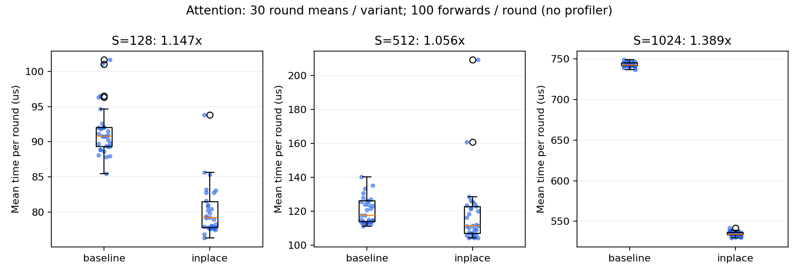
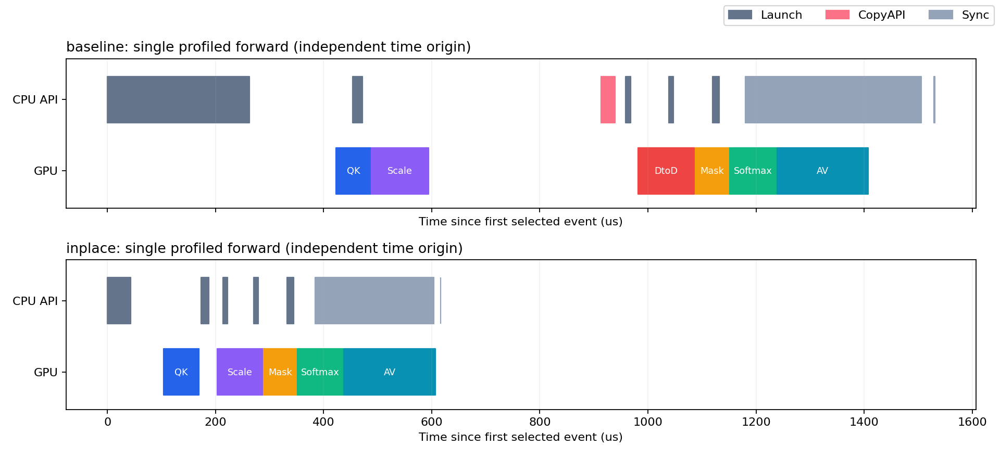

# W9 实验报告：CUDA 边界验证与 Attention 原地 mask 对照

实验日期为 2026-11-04，结果分析于 2026-11-21 补充。设备为 RTX 4080 Laptop GPU，测量范围为单卡算子与 Attention 前向。

报告的性能数据来自 11 月 4 日运行。11 月 15 日重新编译并验证了当前整数、浮点和 Attention 测试。[正确性回归日志](../../reports/checks/20261115_225202_890241/w9_rebuild_correctness.log)

## 1. 结论

本项目完成了整数与浮点 vector add 的输出检查，以及因果 Attention 的等价性、独立参考和因果性验证。关闭 profiler 的本次对照中，`S=1024` 的 Attention 轮均值中位数由 **742.087 μs 降至 534.324 μs**，耗时下降 **28.00%**，加速比 **1.389×**。三组 ABBA 对照的比值为 1.389×、1.387×、1.390×，在本次会话内较一致。

单次 profile 显示，普通 `masked_fill` 路径有一次 **104.249 μs 的 DtoD 拷贝**，原地 `masked_fill_` 路径没有对应拷贝；两版 mask kernel 分别为 62.820 μs、61.504 μs。因此，明确的结构变化是避免了额外设备内复制，不是把 mask kernel 本身加速到原来的某个比例。profile 事件耗时与无 profiler 基准不能直接相减作精确归因。

`S=128/512` 的收益更小，尤其 S=512 有明显长耗时样本。未进行跨天、独占 GPU、多 dtype 或服务端测试。Compute Sanitizer 因 WDDM 调试接口不可用而未完成，不能宣称已通过内存安全检测。

## 2. 实验问题与实现

### 2.1 Vector add

每个线程计算 `i=blockIdx.x*blockDim.x+threadIdx.x`；只在 `i<N` 时写 `C[i]=A[i]+B[i]`。block 为 256，grid 向上取整。

- 整数实现覆盖六组边界长度，使用非恒定输入、逐元素验证和 CUDA 错误检查。
- 浮点实现：本次补入非零输入与全部元素比较。输入是小整数表示的 float，和可精确表示，使用精确比较；不是一般浮点算法的通用容差策略。
- 分配、主机/设备拷贝和正确性检查在计时之外。预热 100 次，每轮连续 100 次 kernel，测 5 轮。
- N 参数范围 1～2^26，非法参数提前失败。这里的上限是本项目的实现约束，不是 CUDA 的能力上限。

### 2.2 Attention

运算为 `softmax(QKᵀ/sqrt(D) + causal_mask)V`，其中未来位置填负无穷。对照只改变 mask 是否原地执行。scores 是该次前向内部的新中间张量，且使用 `no_grad`；结论不推广到梯度或别名共享场景。

输入固定 `B=1,H=8,D=64`，S 为 128、512、1024，dtype 为 FP32，seed=42，TF32 关闭。每个 S 的所有版本与组共用相同 q/k/v/mask。profile 与 benchmark 调用同一份实现，标记范围只在 profile 时开启。

## 3. 环境、口径与复现

| 项目 | 本次条件 |
|---|---|
| GPU | NVIDIA GeForce RTX 4080 Laptop GPU |
| 显存 | 12,878,086,144 字节，约 11.994 GiB |
| 系统 | WSL2 Linux 6.6.114.1，Ubuntu 环境 |
| 驱动 | nvidia-smi 报 Driver Version 596.36 |
| CUDA 编译器 | nvcc 12.8.93 |
| 编译选项 | -O2 -lineinfo -std=c++17 -arch=sm_89 |
| Python | 3.12.3 |
| PyTorch / runtime | 2.13.0+cu132 / CUDA 13.2 |
| 电源与后台 | 是否插电、电源模式未记录；显示 GPU 有 Xwayland 等活动，非独占环境 |

原始证据在 [完整运行目录](../results/final_20261104_2/)，准确起止时间见 `environment.json` 和 `environment_after.json`，源码标识见 `source_sha256.txt`。依赖快照见 `environment.freeze.txt`。

```bash
cd w9  # from the repository root
bash scripts/run_all.sh results/my_reproduction
```

需要指定一个尚不存在的输出目录。构建、测试、基准和 profile 依次运行，不重叠 GPU 测试。

Attention 每组按 baseline → inplace → inplace → baseline，重复 3 组；每个位置先预热 100 次，再测 5 轮，每轮连续 100 次前向。每版、每个 S 共 30 个轮均值样本。CUDA Event 记录区间，等待 end event 后读数并除以 repeats，单位 μs。

这些是连续调用的平均前向区间，可能包括提交不及时造成的 GPU 空闲，不是单请求延迟分布，不计算 P95 服务延迟。median 是 30 个轮均值的中位数；分组比值是同组两版各 10 个轮均值中位数之比。ABBA 用于减轻顺序偏差，不等于排除温度、时钟和后台干扰。

## 4. 正确性与检查结果

| 检查 | 覆盖 | 结果 |
|---|---|---|
| 整数 vector add | N=1/255/256/257/1000/1025，所有元素 | 全部 PASS |
| 浮点 vector add | N=1000，及四个正式计时规模的所有元素 | 全部 PASS |
| 参数错误 | 0、-1、abc、123abc、67108865 | 全部拒绝，非零退出 |
| 两版 Attention 等价 | S=1/127/128/512/1024 | 全部通过，rtol=1e-5、atol=1e-6 |
| 独立 CPU FP64 参考 | S=1/7/33，B=2,H=2,D=16，两种版本 | 全部通过，rtol=1e-4、atol=1e-5 |
| 因果性 | S=33，修改位置 17 起的 q/k/v，比较前 17 个输出 | 两版均通过 |
| Compute Sanitizer | 整数边界程序 memcheck | 环境初始化失败，未验证；浮点 memcheck 未继续运行 |

独立参考按每个 query 单独截取可见前缀，不使用被测实现的 mask 逻辑，可排除两版共同存在的部分实现错误。因果性测试则验证修改未来 token 不影响过去输出；这三种检查不能互相替代。

证据：[测试日志](../results/final_20261104_2/tests.log)、[浮点输出检查](../results/final_20261104_2/vector_correctness.log)、[参数检查](../results/final_20261104_2/invalid_inputs.log)、[memcheck 日志](../results/final_20261104_2/memcheck_integer.log)。测试不是形式化正确性证明，也没有覆盖反向传播、非连续张量或所有数据类型。

## 5. 无 profiler 性能结果与分析

### 5.1 Attention

| S | baseline 中位数 μs | inplace 中位数 μs | baseline 范围 μs | inplace 范围 μs | 加速比 | 耗时下降 |
|---:|---:|---:|---|---|---:|---:|
| 128 | 90.803 | 79.196 | 85.453～101.642 | 76.311～93.809 | 1.147× | 12.78% |
| 512 | 117.600 | 111.401 | 111.073～140.162 | 104.090～209.314 | 1.056× | 5.27% |
| 1024 | 742.087 | 534.324 | 736.379～748.745 | 529.466～541.716 | 1.389× | 28.00% |

原始数据：[attention.csv](../results/final_20261104_2/attention.csv)。每行明确记录 group、position、round、版本、seed、warmup、repeats 和单位。



图中每个点是 100 次前向的平均时间，共 30 点/版本/形状。三个子图纵轴范围不同，适合看同形状的分布，不应以柱高或点的相对位置跨图比较绝对差异。

#### 序列越长，为什么这次在 1024 才拉开明显差距

三个形状的两版中位数分别相差 **11.6、6.2、207.8 μs**。分数张量的体积随 S² 增长，对应 **0.5、8、32 MiB**。当 S=1024 时，普通版本多处理一份 32 MiB 的中间张量，复制本身需要读取源并写入目标。第 6 节也拍到了这次复制，因此大张量的数据搬运是最直接的解释。较小形状上的这部分成本可能更容易被缓存、调用开销和测量波动掩盖，实际收益也没有随 S 单调增加。S=128 与 S=512 的表现适合先按各自实测值解读。

#### S=512 的慢样本发生在哪里

原地版本最高的两个轮均值 **209.314、160.666 μs** 都出现在第 3 组第 2 个测量位置的前两轮。这个位置接下来的三轮约为 **107.4、106.8、104.8 μs**，很快回到常见水平。这个集中出现又恢复的模式，更像短时运行状态变化。主机提交间隙、GPU 时钟变化或后台显示工作都可能造成这种现象。对照的典型差距只有约 6 μs，所以这种短时波动特别容易改变单轮快慢。把原样本保留在图中后，仍可看到三个分组的中位数方向一致，收益幅度则只有约 4%～7% 的加速比增量。要区分这些原因，可以交错复测几次并同步记录 GPU 时钟和后台负载，观察高值是否总落在同一测量位置。

### 5.2 Vector add

| N | 中位数 μs | 范围 μs | 有效带宽中位数 GB/s |
|---:|---:|---|---:|
| 1,024 | 4.964 | 4.577～6.132 | 2.48 |
| 262,144 | 7.148 | 6.103～10.465 | 440.09 |
| 2,097,152 | 11.500 | 11.366～12.728 | 2,188.42 |
| 16,777,216 | 586.957 | 585.974～618.209 | 343.00 |

#### 为什么规模增大后，有效带宽先升再降

按两次读和一次写计算，四组逻辑工作集依次为 **12 KiB、3 MiB、24 MiB、192 MiB**。从 N=1,024 到 N=262,144，数据量增加 256 倍，时间只从 4.964 增至 7.148 μs。这符合小规模时启动与提交成本占比高的预期。数据量增加后，固定成本被更多元素分摊，有效带宽随之上升。

当工作集从 24 MiB 增至 192 MiB，数据量扩大 8 倍，耗时却扩大约 51 倍。连续 100 次执行一直使用相同的三个缓冲区，24 MiB 这组可能享受较多缓存复用，而 192 MiB 这组可能更频繁地访问显存。这样也能解释为何有效带宽从 2,188 降到约 343 GB/s。这里的有效带宽按逻辑字节数计算，缓存命中的访问也计入分子。想验证缓存解释，可以固定 N，对照单套缓冲与轮换多套缓冲，再观察耗时和 DRAM/L2 计数。

旧数据在 `results/w9_review/vector_benchmark.txt`；由于旧实现使用零输入、没有输出验证、编译条件和环境也不完全一致，旧表不用于宣称本次整理带来了性能提升。

## 6. 时间线与瓶颈假设

### 6.1 GPU 拷贝证据

| 项目 | baseline | inplace |
|---|---:|---:|
| 实际 GPU kernel 数 | 5 | 5 |
| DtoD 拷贝次数 | 1 | 0 |
| DtoD 时长 | 104.249 μs | 无对应事件 |
| mask kernel 时长 | 62.820 μs | 61.504 μs |

profile 输入 S=1024，scores 为 `[1,8,1024,1024]`，FP32 占 32 MiB。复制这一张量逻辑上需要读、写共约 64 MiB，但没有计数器就不能把这个估算当成 DRAM 实际流量。



这是两次**分别采样**的前向，每个面板从自身最早选中事件开始计时。CPU API 轨道只画启动、复制 API 和同步；GPU 轨道画实际 kernel 和 DtoD。未画出的 Python/CPU 操作不代表没有发生。

baseline 的 GPU 轨道按 QK → Scale → DtoD → Mask → Softmax → AV 排列。原地版少一次 DtoD，两版 mask kernel 只相差约 1.3 μs。普通版复制前，GPU 从 Scale 结束到 DtoD 开始还有约 387 μs 的间隙，同一份 trace 中首次启动 API 也约为 263 μs。普通版本先准备新的结果张量再提交复制，可能增加主机工作和 GPU 等待。单次采样的记录开销也可能拉长这些间隙。无 profiler 时的 207.8 μs 差额可以来自复制及其周边开销，现有两种口径适合一起判断变化方向。

CPU `cudaDeviceSynchronize` 主等待分别约 325.7 μs、219.8 μs，是等待 GPU 已提交工作完成的主机时间，与 GPU 执行重叠，不能当作另一项 GPU 运算与 kernel 时间相加。两次 profile 的 CPU 范围也不应当作计时基准。

完整事件：[trace_events.csv](../results/final_20261104_2/trace_events.csv)、[baseline JSON](../results/final_20261104_2/traces/baseline.json)、[inplace JSON](../results/final_20261104_2/traces/inplace.json)。汇总脚本只统计原始 JSON 中实际 GPU 完整事件，避免把算子、用户标记和 kernel 重复求和。

### 6.2 历史 Nsight 排队证据

归档的 [kernel_trace.txt](../archive/pre_cleanup_20261104/kernel_trace.txt) 中，前几次后续启动的 Queue Dur 从约 24.651 μs 增至 53.182 μs，而 Kernel Dur 从约 10.238 μs 到 10.178 μs，变化很小。对应 API Dur 约为数 μs。

这符合主机提交比 GPU 执行更快、待执行工作积累的现象；排队时间增长不等于单个 kernel 变慢。首个 API 约 934 μs，明显不同于后续，不能拿它代表稳定启动开销。这里是历史工具记录的解释，不与本次 Event 基准混为一组实验。

### 6.3 假设的检验结论

假设：普通 mask 存在可避免的中间复制，原地 mask 能减少该开销，收益与形状和运行环境有关。

证据链：两版输出检查通过 → trace 中对应 DtoD 消失 → 关闭 profiler 后同输入对照出现形状相关收益。证据支持这一局部优化方向，但无法把全部前向收益精确拆分为复制、分配、提交间隙等各自的贡献。没有测量峰值显存，不能给出峰值显存下降数字。

## 7. 实验范围与复现限制

本报告的性能结论适用于所测单卡 FP32 前向。GPU 同时承担显示任务，尚缺跨会话性能复测。Compute Sanitizer 受 WDDM 调试接口限制，内存检查状态为未验证。后续可通过轮换缓冲和 DRAM/L2 计数进一步验证缓存假设。测试整理、数据核验和文档撰写使用了 AI 辅助。


参考资料：[PyTorch CUDA 语义与异步计时](https://docs.pytorch.org/docs/stable/notes/cuda.html#asynchronous-execution)、[CUDA Best Practices Guide](https://docs.nvidia.com/cuda/cuda-c-best-practices-guide/index.html)。方法说明参考官方文档，实验数据与观察来自本项目保存的运行记录。

